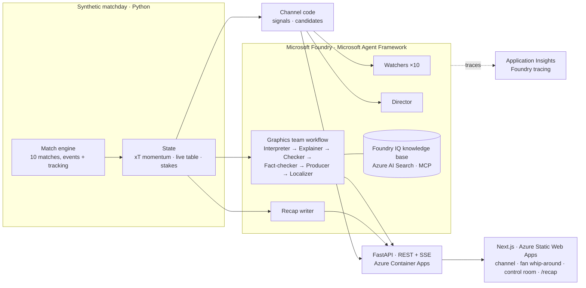

# Tiki-Taka

**Every match of the matchday on one channel, directed by a team of AI agents on Microsoft Foundry. Every cut says why.**

Ten matches kick off at once. A Watcher agent follows each one; a Director agent decides where the channel cuts, weighing how hard a side is pushing against what a goal would change in the live table, and says why we're there and what's at stake. A signed-in fan gets their own channel, cut by what matters to their club or to their fantasy XI. Every sentence on screen cites the events behind it and passes a code checker before it airs; a human producer can take, hold, or pin any cut, and approves the graphics on the featured match.

The demo is set on the season's last matchday, when the title, the top four, the drop, and the Golden Boot are all decided at once. The same channel covers any matchday.

> Built for the **Inside the Game** developer hackathon (Microsoft x Premier League). All clubs, players, and matches are fictional and synthetic.

## Try it

**[Open the channel](https://polite-pebble-04e918210.5.azurestaticapps.net/)** (no sign-in; the backend may take half a minute to wake on a first visit)

Every visit starts at 55' of matchday 38. Then:

1. **Watch the channel.** The Director cuts between the ten matches; each cut says why we're here, what's at stake in the table, and the story so far. The table moves with every goal.
2. **Switch to Fan** (top right) and pick a club or a fantasy XI: the channel becomes yours, cut by what matters to you. Or open **[two fans side by side](https://polite-pebble-04e918210.5.azurestaticapps.net/split/)**: the same goal, cut to and told for each.
3. **Switch to Producer.** Take, hold, or pin cuts; run a **failure drill** (take an agent down and watch the system fall back); open the featured match's **control room**, where the graphics team's proposals wait for approval (A approve, E edit, R reject), each with its receipts.
4. **Skip to the end.** As the producer, *Skip to the final whistle*; or open **[/recap](https://polite-pebble-04e918210.5.azurestaticapps.net/recap/)** for how the matchday ends, written by the agents (it gives the results away).

## The agents

| Agent | Its job | Model | Checked by |
|---|---|---|---|
| **Watcher** (one per match) | The story of its match so far, from that match alone; its recap at the final whistle | gpt-6-luna | Code checker; fact-checker for recaps |
| **Director** | Where the channel cuts, from the code's top three candidates, inside a 5-second countdown; why, and what's at stake | gpt-5.4-mini | Code checker |
| **Interpreter** | Whether a moment on the featured match deserves a graphic, and its angle | gpt-5.4-mini | |
| **Explainer** | The graphic, every claim citing events; looks up club tactics, the laws, and metrics in a Foundry IQ knowledge base over MCP | gpt-5.4-mini | Code checker, then fact-checker |
| **Fact-checker** | A verdict on every statement: supported, fair reading, unsupported, or wrong | gpt-5.4-mini; gpt-6-luna for recaps | |
| **Producer** | Priority and shelf life in the human producer's queue, learning from what they approve | gpt-5.4-mini | |
| **Localizer** | Analyst and casual versions, in English and Spanish | gpt-5.4-mini | Code checker |
| **Recap writer** | How the matchday unfolded, from facts code worked out | gpt-6-luna | Code checker, then fact-checker |

Code does what code should: the match engine, the xT model behind momentum and pressure, the live table and what each goal would change, the candidates for every cut, and the checker that holds every answer to its brief (each claim cites events that exist; every number, name, and score comes from them). A rejected draft goes back with the problems; if it still fails, the code-written version airs instead.

## Does a team do better than one agent?

We measured it ([docs/evals](docs/evals/README.md)), with Microsoft Foundry's evaluators as the judge and the single agent given the same briefs, tools, and the specialists' instructions word for word.

**The whip-around**, on every cut of a session (23): the team against one agent watching all ten matches, on each of the two models.

| | Watchers + Director | One agent, fast model | One agent, accurate model |
|---|---|---|---|
| On air with something the checker rejects | **0** | 8 | **0** |
| Foundry groundedness (1-5) | **4.82** | 3.75 | 4.77 |
| Decided before the countdown ends | 78% | 87% | 0% |
| Median seconds to the cut | 2.8 | 2.8 | 12.8 |

One agent can be fast or careful: on the fast model it airs errors on a third of cuts; on the accurate one it is as grounded as the team but never makes the 5-second countdown, because it has to read ten matches. The team is both: the Watchers write ahead of each cut on the accurate model, and the Director decides on the fast one with their stories in hand.

**The graphics desk**, on every moment of the featured match (39): the same model, knowledge base, and instructions, as a team or as one agent.

| | Graphics team | One agent |
|---|---|---|
| On air with an unsupported citation, number, or name | **0** | 5 (13%) |
| Foundry groundedness (1-5) | **4.77** | 4.69 |
| Median seconds per moment | 10.1 | **5.0** |

The evals also found real bugs, which is what they're for: a team that grounded *worse* than one agent in an early run (it now has a fact-checker agent), and a last-second winner briefed with the table from before it. [The write-up](docs/evals/README.md) has every run.

## Architecture



## Microsoft technology

| | Used for |
|---|---|
| **Microsoft Foundry** | The project, two model deployments (gpt-5.4-mini for the fast jobs, gpt-6-luna for the accurate ones), **tracing** (every agent run is a trace in Foundry, with each agent's prompt, answer, and tokens), and **evaluations** (groundedness, relevance, coherence) |
| **Microsoft Agent Framework** | Every agent (`Agent`, `FoundryChatClient`), the graphics team as a **workflow** (`WorkflowBuilder` with conditional edges for the redraft loop), the knowledge base as an **MCP tool**, `FoundryEvals`, and its OpenTelemetry instrumentation |
| **Azure AI Search** (Foundry IQ) | The knowledge base the Explainer consults: club tactics, the laws, and what each metric means, generated from the same code the matches are played with |
| **Azure Container Apps** | The backend, scaling to zero when idle; two scheduled **Container Apps jobs** keep it warm through judging |
| **Azure Static Web Apps**, **Azure Container Registry**, **Application Insights**, **Log Analytics**, **managed identity** | The frontend; images built in the cloud; telemetry; no keys anywhere |
| **Bicep** | All of it as code: [infra/](infra/README.md) |

## Built to be trusted

- **Receipts.** Every claim cites the events behind it; the control room highlights them on the pitch and the timeline.
- **A human in the loop.** The producer approves every graphic, can take, hold, or pin any cut, and sees an audit log of every agent step, retry, and decision.
- **Failure recovery.** Every model call gets one retry; when an agent is down, the system falls back on time (the scripted graphic, the last story, the code's pick). The producer's failure drill shows it live.
- **Reproducible.** The matchday is deterministic from its seed on any machine, so each agent's answers are cached per matchday and replayed, and the evals rerun on the same moments.
- **Observable.** Every agent run, live or cached, is traced to Application Insights, connected to the Foundry project; failures, and what aired instead, are marked.

The synthetic data and its realism checks are described in [docs/synthetic-data.md](docs/synthetic-data.md).

## Run it yourself

Prerequisites: [uv](https://docs.astral.sh/uv/), Node.js 24+, and (for the agents) a Foundry project: see [infra/README.md](infra/README.md).

```bash
make install        # backend (uv) + frontend (npm) dependencies
make dev-backend    # API on http://localhost:8001 (no Foundry project, or MATCHDESK_AGENTS=off: code writes everything)
make dev-frontend   # the app on http://localhost:3000 (a second terminal)
make test           # backend tests
make evals          # the graphics team vs a single agent, judged on Foundry (~$2)
cd backend && uv run python -m app.evals.whip   # the whip-around vs a single agent (~$2)
```

| Path | Contents |
|---|---|
| `backend/app/generator` | The synthetic matchday: match engine, tactics, storylines, the season, validation |
| `backend/app/state` | xT, momentum, the live table and stakes, the Golden Boot, fantasy points |
| `backend/app/live` | The channel's Director logic, the graphics desk, recaps, the matchday clock |
| `backend/app/agents` | The agents, their briefs and checkers, tracing, and the failure drill |
| `backend/app/evals` | The evals behind [docs/evals](docs/evals/README.md) |
| `backend/app/models` | The data contracts, exported to JSON Schema and TypeScript (`make types`) |
| `frontend/` | Next.js (static export): the channel, match pages, control room, recap |
| `infra/` | Bicep for Foundry, AI Search, and hosting |
